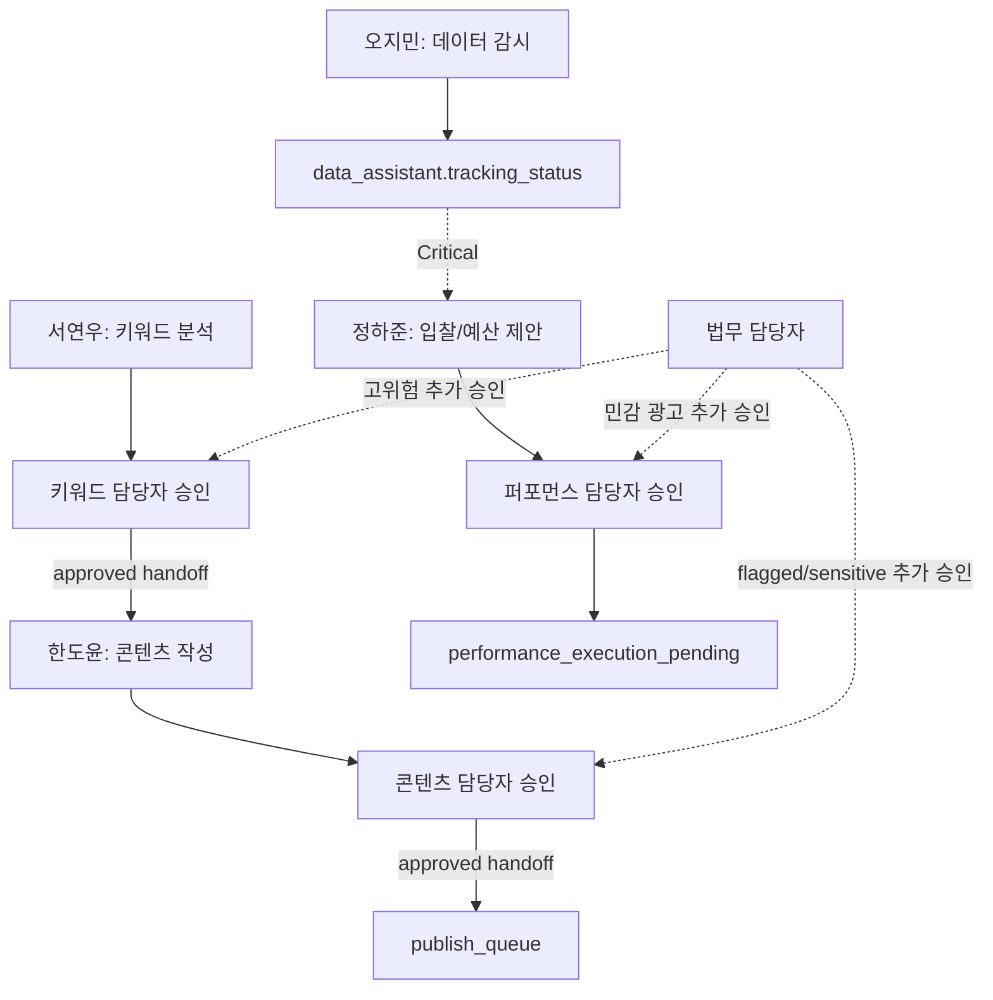

# Hermes AI 전체 시스템 흐름

Hermes는 AI 직원의 산출물, Human 승인, handoff, 외부 실행을 분리한다.
현재 Phase 1은 플랫폼 독립적인 승인 엔진만 제공하며 Slack UI는 Phase 3에서 연결한다.

## 역할별 완료 조건

| AI 직원  | 기본 Human 역할        | 추가 조건                                                              |
| -------- | ---------------------- | ---------------------------------------------------------------------- |
| 키워드   | `keyword_approver`     | high면 `legal_compliance`                                              |
| 콘텐츠   | `content_approver`     | flagged/sensitive면 `legal_compliance`                                 |
| 퍼포먼스 | `performance_approver` | 큰 조정/PAUSE는 `operations_owner`, 민감 광고는 `legal_compliance`     |
| 데이터   | 승인 없음              | Warning/Critical은 `data_owner` 확인, privacy는 `privacy_officer` 확인 |

요구 역할이 여러 개면 서로 다른 사람이 승인한다. 확인이나 승인은 외부 게시·광고 변경을 의미하지 않는다.

## 승인과 handoff

1. AI 결과를 `work_items` v1로 저장한다.
2. 정책에 따라 `approval_requests` 및 필수 역할을 생성한다.
3. 필수 승인이 모두 끝나기 전에는 handoff를 생성하지 않는다.
4. 승인 완료 시 `(work_item_id, version, handoff_type)` 고유 handoff를 생성한다.
5. 수정 요청은 기존 버전을 종료하고 승인 이력이 없는 새 버전을 만든다.

## 트래킹 예외 경로

- `Normal`: 상태만 저장한다.
- `Warning`: `data_owner` 확인을 요구한다.
- `Critical`: 퍼포먼스 제안을 보류하고 `data_owner` 확인을 요구한다.
- privacy flag: `privacy_officer` 확인을 추가한다.
- 확인은 차단 해제가 아니며 복구·재개는 별도 승인 요청으로 처리한다.
